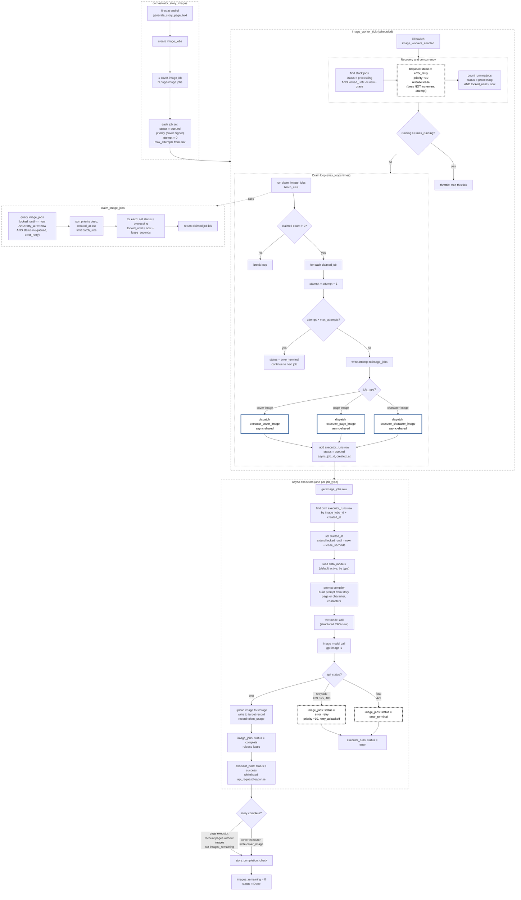

# Image Generation Flow

Documents the image generation pipeline from the orchestrator that queues jobs, through the scheduled worker tick that claims and dispatches them, to the three async executors that generate the images.

This is a subprocess of [[story-creation-flow]] step 9.

## Diagram

Blue bordered nodes dispatch the async executors. Dashed black bordered nodes are the state transitions involved in the duplication and retry logic under investigation.

## The correlation key

The executor finds its own `executor_runs` row using `image_jobs_id` plus `created_at` as a compound key (step E2). This depends on `created_at` being immutable. If anything rewrites `created_at` after the row is created, this lookup can match the wrong row or match ambiguously, which is a live suspect in the duplication investigation.

## Lease lifecycle

The lease (`locked_until`) is the mechanism that stops two ticks claiming the same job:

1. `claim_image_jobs` sets `locked_until = now + lease_seconds` when it claims a job and marks it `processing`.
2. The executor extends `locked_until = now + lease_seconds` again when it actually starts.
3. On completion or error the executor releases the lease (`locked_until = now`).
4. The reaper only requeues a job whose lease expired more than `grace` seconds ago.

The claim query only selects jobs where `locked_until <= now`, so a validly leased job is invisible to it. Duplication occurs when a job becomes visible to the claim query while it should still be leased, for example when the lease value is written incorrectly (the epoch/1970 bug) or when the lease has genuinely expired because execution started far later than claim.

## Known issues under investigation

- **created_at overwrite.** `created_at` values on jobs or runs have been observed changing after creation (for example 15:07 to 15:11). Since `created_at` is the executor's correlation key, this must be found and stopped. Check every `db.edit` in the tick and executors for any that writes `created_at`.
- **Lease value integrity.** `lease_seconds` from the env var must be cast to int before `add_secs_to_timestamp`, or `locked_until` is written as epoch (1970), making the job permanently claimable. Confirmed and fixed in `claim_image_jobs`.
- **Intra-tick re-claim.** The drain loop calls `claim_image_jobs` up to `max_loops` times per tick. If a claim's `processing` write is not visible to the next loop's query, the same job could be claimed twice within one tick.
- **Duplicate cost.** Every duplicate claim results in a second full image generation, incurring OpenAI cost and consuming an async pool slot.

## Related notes

- [[story-creation-flow]]
- [[defer-image-pipeline-throughput-to-phase-2]]
- [[13. AI Text Generation - OpenAI]]
- [[14. AI Image Generation - OpenAI]]