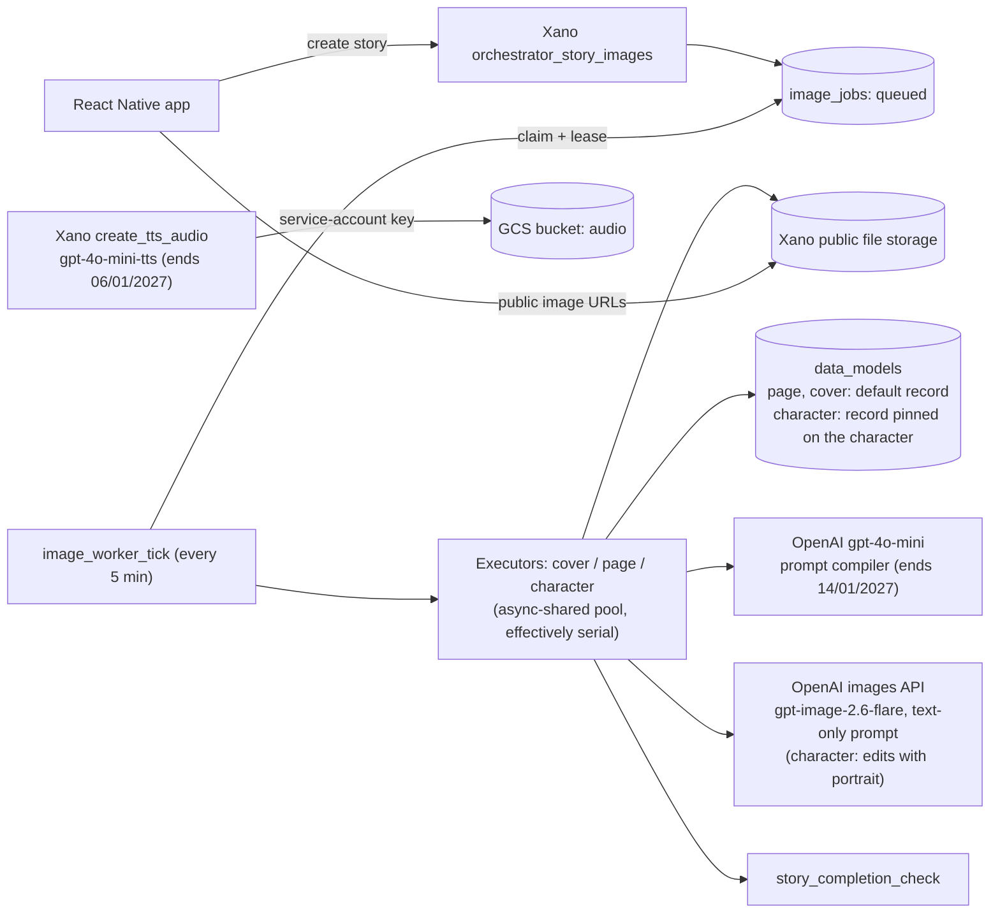
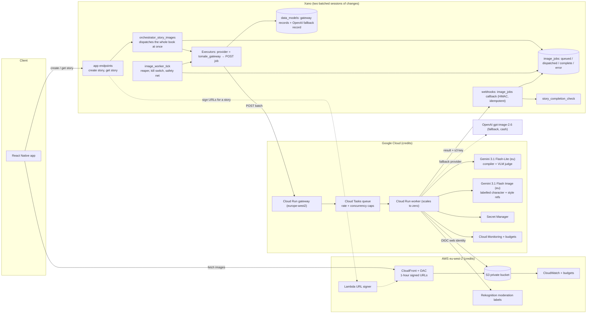
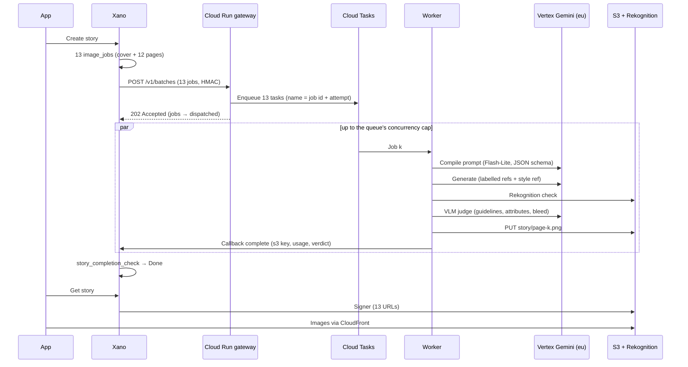

# Image pipeline: as-is and future state

Draft for [[PRD-Image-Pipeline]]. [[image-generation-flow]] stays the record of what's live, and is rewritten from this note at cut-over (IP-16).

## As-is (after Session 0)

**Limits:**
- The 5-minute tick and serial pool give 10–15 minutes per book.
- Page and cover images get no reference picture.
- No output image moderation.
- Public URLs.
- Paid in cash.

## Future state

The app still reads image URLs from Xano. Xano asks the signer for a story's URLs in one call, so it never holds the CloudFront private key.

## One book, 13 images in parallel

**Expected timing** (to confirm in the load test): compile 2–5 s, generate 10–40 s, moderation 3–6 s. That's about a minute per book with no queueing. Under load, the Cloud Tasks queue behind dynamic quota is what stretches it.

## Failure paths

- **Retryable** (429, 5xx, provider safety finish with a softened prompt): Cloud Tasks retries with backoff. On the final attempt the worker posts `error_retry` or `error_terminal`.
- **Callback lost:** the job stays `dispatched` until its lease expires, then the reaper requeues it. The idempotent task name stops double generation within a retry window.
- **Rollback:** set the OpenAI fallback record as the default for that type. Jobs in flight finish through the callback.
