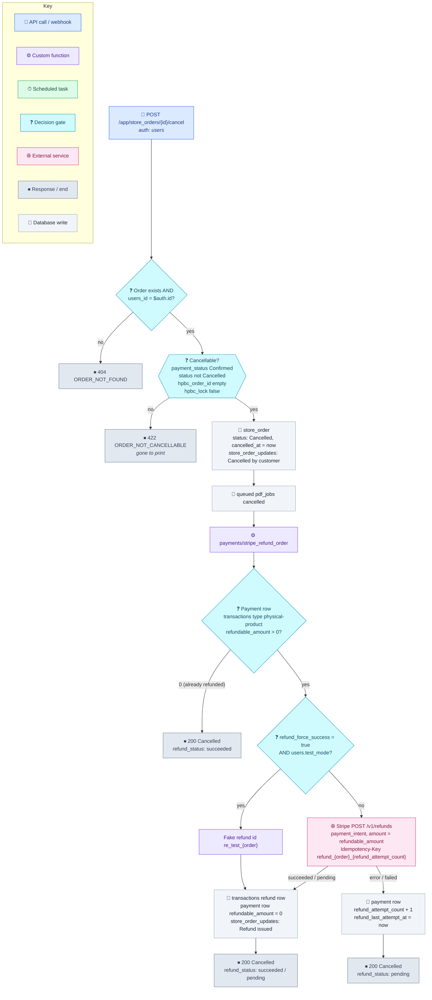
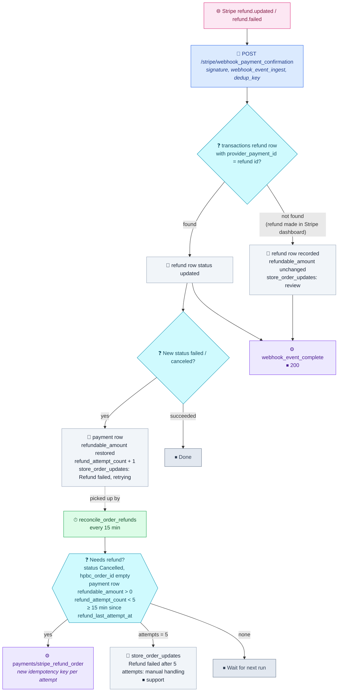

# Order Cancellation and Refund Flow

How a customer cancels a paid print order during the cancellation window, and how the self-service refund is issued, retried and reconciled with Stripe. Companion to [[order-fulfilment-flow]].

Scope: this is the **self-service, pre-production** path only, per [[split-refund-model-into-self-service-and-support-paths]]. Misprint and quality refunds are support-driven and go through a future account-credit ledger. They never touch `refundable_amount`.

---

## 1. Customer cancel and refund

---

## 2. Retrying and reconciling refunds

---

## Rules

- **Cancellable window:** from payment until `hpbc_submit_due_orders` claims the order: `submit_after` (30 min, or 1 min for test users) plus up to one 60-second task interval. After submission, cancellation is closed. Personalised goods are exempt from the 14-day cancellation right (Consumer Contracts Regulations 2013, reg. 28(1)(b)); confirm the wording in the terms.
- **Order before money:** the order is set to Cancelled before the refund is attempted, so a failed refund can never let a cancelled order print.
- **Full refunds only** on this path, for the amount in `refundable_amount` on the original `transactions` row (type `physical-product`).
- **Idempotency key** `refund_{store_orders_id}_{refund_attempt_count}`. A network retry reuses the key and Stripe returns the same refund. After a confirmed failure the count increases, so the next attempt is a fresh refund. Stripe keeps a key's result for 24 h.
- **Test mode:** with `refund_force_success = "true"` and `users.test_mode = true`, Stripe is skipped and a fake `re_test_` id is recorded. Postman's simulated payments have no real payment intent. `refund_force_success` must be `"false"` in prod.
- **Webhooks never read `$auth`.**

## Tables and fields

| Table | Fields used |
|---|---|
| `store_orders` | `status`, `payment_status`, `hpbc_order_id`, `hpbc_lock`, `submit_after`, `cancelled_at` |
| `store_order_updates` | `store_orders_id`, `message`, `created_at` |
| `transactions` (payment row) | `type` = physical-product, `provider_payment_id` (payment intent), `amount_minor`, `currency`, `refundable_amount`, `refund_attempt_count`, `refund_last_attempt_at` |
| `transactions` (refund row) | `type` = refund, `provider_payment_id` (`re_…`), `amount_minor`, `currency`, `status`, `users_id`, `store_orders_id` |
| `transaction_webhook_events` | `dedup_key`, `event_type`, `status`, `processing_errors` |
| `pdf_jobs` | queued jobs for the order are cancelled |

## Open points

- `store_orders.payment_status` is not set to `Refunded` when a refund succeeds. The value exists in the enum, so add the write in `stripe_refund_order` (and in the webhook handler, if it confirms a pending refund).
- There is no customer notification yet for a cancellation or refund (in-app alert or Resend email).
- The support-driven refund / account-credit ledger is a future item.

## Related notes

- [[order-fulfilment-flow]]
- [[split-refund-model-into-self-service-and-support-paths]]
- [[record-transactions-drop-checkout-session-object]]
- [[store-money-as-integer-minor-units]]
- [[differentiate-ingest-vs-processing-failure-responses-for-webhooks]]
