# Order and Fulfilment Flow

End-to-end lifecycle of a `store_order`: creation, payment, PDF generation, the 30-minute cancellation window, delayed submission to HPBC (Pureprint), and HPBC status callbacks. Cancellation and refunds are covered in [[order-cancellation-and-refund-flow]].

> **Revision 2026-10-14.** HPBC submission no longer runs from the `order_fulfilment_check` DB trigger. Orders now wait until `submit_after` and are submitted by the `hpbc_submit_due_orders` background task. This revision also adds the HPBC status guard, the Error handling in `hpbc_create_order`, renames Delivered to Shipped, and maps Pureprint's real trigger names. The Error-on-timeout behaviour assumes the `hpbc_create_order` 2026-10-14b revision.

---

## Flowchart

```mermaid
flowchart TD
    subgraph Key[" Key "]
        direction LR
        k1["🔗 API call / webhook"]
        k2["⚙ Custom function"]
        k3["🔄 Async job"]
        k8["⏱ Scheduled task"]
        k4["❓ Decision gate"]
        k5["🌐 External service"]
        k6["⏹ End / waiting state"]
        k7["💾 Database write"]
    end

    A["🔗 User creates order<br/>POST /app/store_orders<br/><i>status: Draft</i>"]
    B["🔗 User edits order<br/>PATCH /app/store_orders/{id}<br/><i>Draft only, server-derived totals</i>"]
    C["🔗 App starts checkout<br/>GET /app/stripe/create_checkout_session<br/><i>Stripe total checked against Xano price<br/>writes checkout_session_id</i>"]
    D{"🌐 User pays on Stripe"}

    A --> B --> C --> D

    D -->|payment succeeds| E["🔗 Stripe webhook<br/>POST /stripe/webhook_payment_confirmation<br/><i>signature + dedup_key</i>"]
    D -->|abandons / fails| DX["⏹ Order stays Payment Pending<br/>retry or expire"]

    E --> F["💾 store_order<br/>status: Payment Confirmed<br/>payment_status: Confirmed<br/>submit_after = now + 30 min<br/><i>(1 min for test_mode users)</i>"]
    E --> TX["💾 transactions row<br/>type: physical-product<br/>refundable_amount = amount_minor"]
    E --> G["⚙ orchestrator_pdf_generation<br/>creates pdf_jobs (idempotent)"]

    F -.->|app polls| P["🔗 GET /app/stripe/check_order_paid"]
    F -.->|"customer can cancel until submitted"| CXL["🔗 POST /app/store_orders/{id}/cancel<br/>see cancellation and refund flow"]

    G --> H["🔄 PDF worker tick<br/>Papermill renders cover + inner"]
    H --> I["💾 store_order<br/>cover_pdf + inner_pdf"]

    T0["⏱ hpbc_submit_due_orders<br/>every 2 min, max 20 orders"] --> J{{"❓ Due for submission?<br/>payment_status Confirmed<br/>status not Cancelled / Error<br/>cover_pdf AND inner_pdf<br/>hpbc_order_id empty, hpbc_lock false<br/>submit_after ≤ now"}}
    I -.-> J
    F -.-> J

    J -->|no| Z["⏹ Wait for next tick"]
    J -->|yes| K["⚙ reconcile_order_fulfilment"]

    K --> L["💾 hpbc_lock = true<br/>then re-read order"]
    L --> L2{"❓ Cancelled since?"}
    L2 -->|yes| LX["💾 hpbc_lock = false<br/>⏹ stop"]
    L2 -->|no| M["⚙ hpbc_create_order<br/><i>staging SKU unless test_mode = false</i>"]

    M --> M2{"❓ Outcome"}
    M2 -->|"HPBC 200 / 201"| N["💾 hpbc_order_id written<br/>hpbc_lock = false"]
    M2 -->|"check fails / HPBC non-2xx<br/>/ timeout"| ER["💾 status: Error, hpbc_lock = false<br/>store_order_updates reason<br/>⏹ manual fix"]

    N --> O["🌐 HPBC / Pureprint fulfilment"]
    O --> Q["🌐 HPBC triggers"]
    Q --> R["🔗 POST /hpbc/webhook_statusCallbackUrl"]
    Q --> S["🔗 POST /hpbc/webhook_statusCallbackUrl_Error"]
    R --> GD{{"❓ Status guard<br/>hpbc_update_order"}}
    S --> GD

    GD -->|"allowed transition"| T["💾 store_order.status updated<br/>tracking merged, update logged"]
    GD -->|"not allowed<br/>(e.g. Error after Shipped)"| T2["💾 update logged only<br/>status unchanged"]

    T --> U{"❓ Status now"}
    U -->|"Order Confirmed / In Production"| Q
    U -->|"Error (may recover)"| Q
    U -->|"Shipped / Cancelled"| END["⏹ End state"]

    classDef apiCall fill:#dbeafe,stroke:#2563eb,color:#1e3a8a;
    classDef function fill:#ede9fe,stroke:#7c3aed,color:#4c1d95;
    classDef asyncJob fill:#fef3c7,stroke:#d97706,color:#78350f;
    classDef task fill:#dcfce7,stroke:#16a34a,color:#14532d;
    classDef gate fill:#cffafe,stroke:#0891b2,color:#164e63;
    classDef external fill:#fce7f3,stroke:#db2777,color:#831843;
    classDef terminal fill:#e2e8f0,stroke:#64748b,color:#334155;
    classDef write fill:#f1f5f9,stroke:#94a3b8,color:#1e293b;

    class k1 apiCall;
    class k2 function;
    class k3 asyncJob;
    class k8 task;
    class k4 gate;
    class k5 external;
    class k6 terminal;
    class k7 write;

    class A,B,C,E,P,R,S,CXL apiCall;
    class G,K,M function;
    class H asyncJob;
    class T0 task;
    class J,L2,M2,GD,U gate;
    class D,O,Q external;
    class DX,Z,END terminal;
    class F,TX,I,L,LX,N,ER,T,T2 write;
```

---

## Status vocabulary

`store_orders.status` moves through Draft, Payment Pending, Payment Confirmed, Order Confirmed, In Production and Shipped. The off-path states are Cancelled and Error. Delivered was renamed to Shipped on 2026-07-15 ([[scope-hpbc-callbacks-to-six-customer-facing-statuses]]).

`store_orders.payment_status` takes the values Pending, Confirmed, Refunded, Cancelled and Error.

### HPBC trigger → status mapping

| Pureprint trigger | Callback endpoint | `store_orders.status` |
|---|---|---|
| Order Errored (malformed request) | `_Error` | Error (usually also caught as non-2xx at submission) |
| Order Received | success | Order Confirmed |
| Order Submission Error (bad PDF / expired link; Pureprint retries up to 24 h) | `_Error` | Error, recoverable by a later forward status |
| Order Print Ready (batched, cannot back out) | success | In Production |
| Component Printed | none | (no customer-facing change) |
| Shipment Shipped | success | Shipped, with `tracking_url` / `tracking_number` |
| Order Cancelled | success | Cancelled |

### Status guard rules (`hpbc_update_order`)

- Statuses only move forward: Order Confirmed → In Production → Shipped.
- Error is accepted only before Shipped. A later forward status recovers an order from Error.
- Cancelled is accepted only before In Production. It is terminal.
- Tracking is always merged with `first_notempty`, even when the status change is not applied.
- Every callback is logged to `store_order_updates`.
- A callback with an empty `hpbc_order_id` or status is rejected.

---

## Idempotency guards along the path

1. **Stripe webhook.** The `transaction_webhook_events` unique `dedup_key` stops a re-sent event from reaching the order or the transaction write. `submit_after` is only set if it is empty.
2. **PDF orchestration.** An existing-jobs check means a second call creates no new jobs.
3. **HPBC submission.** The task only selects unlocked orders with no `hpbc_order_id`. Reconcile sets the lock and re-reads the order, and `hpbc_create_order` refuses orders that are already submitted or cancelled.
4. **HPBC callbacks.** `transaction_webhook_events` dedup handles repeated events, and the status guard stops out-of-order events from moving the status backwards.
5. **Refunds.** A Stripe idempotency key is used per attempt. See [[order-cancellation-and-refund-flow]].

---

## Open questions and risks

- **Lock is not a single atomic check-and-set.** Reconcile sets `hpbc_lock` and then re-reads the order. With one background task submitting orders one at a time, a double submission is very unlikely but not impossible.
- **A timeout may hide a successful submission.** If the HPBC request times out after Pureprint accepted the order, the order is marked Error for a manual check rather than retried. Waiting for Alex: does Pureprint reject a repeated `sourceOrderId`? If it does, timeouts can retry automatically.
- **Cancel vs submit race.** A cancel can land in the milliseconds between the lock re-read and the HPBC request, so the order is printed and also refunded. Accepted risk.
- **Approval is based on the web view, not the PDF.** The printed book could differ from what the customer approved (text overflow, cropping). Mitigated by Papermill template checks and Pureprint's PDF/X-4 preflight.
- **`store_orders.created_at` is being overwritten.** Under investigation with the `audit_store_orders` trigger.
- **Money units drift.** `store_orders.subtotal` / `shipping_amount` are decimal pounds, while `transactions.amount_minor` is integer pence ([[store-money-as-integer-minor-units]]).
- **`hpbc/webhook_order_submission` may be dead.** Confirm and remove it in the cleanup sweep.

Resolved since the 2026-07-14 version:

- The synchronous HPBC call inside the DB trigger is gone; submission runs from a background task.
- `check_order_paid` is now authenticated and scoped to the owner.

---

## Documentation drift noted

- `PRD-Store-Orders` and `PRD-Order-PoD-System` still name **Mixam**. The live provider is **HPBC / Pureprint**.
- `PRD-Order-PoD-System` uses an old state machine and old table names. The live schema uses `store_orders`, `store_order_updates` and `transactions`, with the vocabulary above.
- Neither PRD covers the cancellation window or self-service refunds.

Treat this file as the source of truth for the fulfilment flow until the PRDs are updated in the documentation refresh.
