# Story Creation Flow

Covers the path from initial story creation to a story complete enough to enter the order fulfilment flow. Steps are either user or chatbot triggered (via an authenticated endpoint) or automated (custom function, trigger, or worker drain loop).

Downstream of this sits order-fulfilment-flow-test-scripts, which begins at checkout session creation.

Updated 2026-10-12 after the stuck "In Queue" investigation: status lifecycle made explicit, moderation `enforcement` values corrected, `story_completion_check` added, and the `/model` step marked surplus. See [[2026-10-12-001]].

## Diagram

```mermaid
flowchart TD
    subgraph S1["Step 1: Story shell"]
        A["User or chatbot<br/>POST /instant_stories"] --> A1["title, subtitle, user_prompt<br/>theme_id, artwork_style_id, total_pages<br/>active default story text data_model applied<br/>profile from auth extras, not client input"]
        A1 --> A2["instant_stories row created<br/>status = Draft"]
    end

    A2 --> B

    subgraph S2["Step 2: Page shells"]
        B["Automated<br/>create instant_story_pages"] --> B1["one row per page<br/>count from total_pages<br/>text empty at this stage"]
    end

    B1 --> C

    subgraph S3["Steps 3 to 4: Characters and name moderation"]
        C["User or chatbot<br/>POST /characters"] --> C1["name, age, physical description"]
        C1 --> D["Automated<br/>content_moderation_name"]
        D --> D1{"name permitted?"}
        D1 -->|"blocked_terms signal<br/>plus AI moderation gate"| D2["Pass"]
        D1 -->|"fail"| D3["Rejected<br/>user prompted to rename"]
        D3 -.-> C
    end

    D2 --> E

    subgraph S4["Steps 5 to 6: Character model and images"]
        E["Automated<br/>generate character model"] --> E1["AI pipeline function<br/>active default character data_model"]
        E1 --> E2["characters row updated<br/>structured JSON model"]
        E2 --> F["image_jobs queued<br/>job_type = character-image"]
        F --> F1["worker tick claims job<br/>executor generates image"]
        F1 --> F2["character cover_image written"]
    end

    F2 -.->|"not required"| X["POST /instant_stories/id/model<br/>SURPLUS: removed from tests<br/>page text writes the synopsis"]
    F2 --> H

    subgraph S5["Step 7: Page text, moderation and story lock"]
        H["User or chatbot<br/>POST /instant_stories/id/page_text<br/>generate_story_page_text"] --> H0{"current status"}
        H0 -->|"Preparing, In Queue,<br/>Done or Blocked"| H0X["returns early<br/>nothing regenerated"]
        H0 -->|"Draft"| H1["validation<br/>user_prompt, theme, artwork style<br/>at least one character<br/>total_pages matches page count<br/>theme and artwork allowed on plan"]
        H1 --> M["content_moderation_story_text<br/>AI moderation of prompt and characters"]
        M --> M1{"enforcement"}
        M1 -->|"none"| M2["status_moderation = Pass<br/>status = Preparing"]
        M1 -->|"require_parental_oversight"| M3["status_moderation = Parental Approval<br/>parental_approval_required = true<br/>parent alerted"]
        M1 -->|"blocked"| M4["status = Blocked<br/>status_moderation = Fail<br/>user alerted, flow stops"]
        M1 -->|"flag_account"| M5["moderation_flags row added<br/>status = Blocked<br/>status_moderation = Fail<br/>flow stops"]
        M1 -.->|"unrecognised value"| M6["PLANNED: fail closed<br/>status = Blocked<br/>not yet built"]
        M2 --> L["story lock<br/>status = Preparing"]
        M3 --> L
        L --> T["AI story text request<br/>up to 5 attempts<br/>token_usage recorded"]
        T --> T1{"succeeded?"}
        T1 -->|"no"| T2["rollback<br/>status = Draft<br/>flow stops, user can retry"]
        T1 -->|"yes"| T3["instant_story_pages.text written<br/>title, subtitle, synopsis written"]
        T3 --> T4["status = In Queue"]
    end

    T4 --> I

    subgraph S6["Step 8: Story images and completion"]
        I["orchestrator_story_images"] --> I1["image_jobs queued<br/>one per page plus cover"]
        I1 --> I2["worker tick drain loop<br/>executor generates image"]
        I2 --> I3["page image or cover_image written<br/>images_remaining decremented"]
        I3 --> SC["story_completion_check"]
        SC --> SC1{"status = In Queue<br/>and images_remaining = 0<br/>and moderation Pass or Parental Approval?"}
        SC1 -->|"no, wait for next image"| I2
        SC1 -->|"yes"| SC2["status = Done<br/>completed_at set<br/>story ready alert sent"]
    end

    SC2 --> V{"status_moderation"}
    V -->|"Pass"| J["visible to child profile<br/>orderable"]
    V -->|"Parental Approval"| W["hidden from child profile<br/>until parent approves"]
    W -->|"parent approves"| J
    J --> K["Order fulfilment flow<br/>see separate diagram"]

    classDef trigger fill:#ffffff,stroke:#1a4d8f,stroke-width:3px,color:#000000
    classDef stop fill:#ffffff,stroke:#000000,stroke-width:2px,stroke-dasharray:4 3,color:#000000
    classDef surplus fill:#f2f2f2,stroke:#999999,stroke-width:1px,stroke-dasharray:2 2,color:#666666
    class A,C,H trigger
    class M4,M5,T2 stop
    class X,M6 surplus

    style S1 fill:none,stroke:#666666,stroke-dasharray:5 4
    style S2 fill:none,stroke:#666666,stroke-dasharray:5 4
    style S3 fill:none,stroke:#666666,stroke-dasharray:5 4
    style S4 fill:none,stroke:#666666,stroke-dasharray:5 4
    style S5 fill:none,stroke:#666666,stroke-dasharray:5 4
    style S6 fill:none,stroke:#666666,stroke-dasharray:5 4
```

Nodes with a heavy blue border are user or chatbot triggered endpoints. Everything else is automated. Dashed black borders mark states where the flow halts. Grey dashed nodes are surplus or planned, not part of the live path.

## Status lifecycle

`instant_stories.status` moves through one path, and each value has a single writer.

| Status | Meaning | Set by |
|---|---|---|
| Draft | Story shell exists, nothing generated yet. Also the rollback state if text generation fails | `POST /instant_stories`; rollback in `generate_story_page_text` |
| Preparing | Moderation passed (or parental approval required), story locked, page text being generated | `content_moderation_story_text` on pass, then the story lock in `generate_story_page_text` |
| In Queue | Page text written, image jobs queued | `generate_story_page_text`, written before `orchestrator_story_images` fires |
| Done | All images written, moderation recorded | `story_completion_check` |
| Blocked | Moderation outcome `blocked` or `flag_account` | `content_moderation_story_text` |

Preparing only exists for the duration of the page text call. From outside (app, tests) a successful call is always observed as In Queue.

`story_completion_check` runs after every image executor and only completes a story when `status = In Queue` AND `images_remaining = 0` AND `status_moderation` is Pass or Parental Approval. Keying off In Queue (not Preparing) is what stops a story being marked Done before any images are queued, and makes a late regeneration on a Done story a no-op.

## Moderation outcomes

`content_moderation_story_text` maps the AI's `enforcement` value (structured output, strict schema). The schema value for a clean result is `none`, not `pass`. The mismatch caused the 2026-10-12 stuck stories: no branch matched, no moderation status was written, and `story_completion_check` could never complete the story.

- **none.** `status_moderation = Pass`, generation proceeds, story visible on completion.
- **require_parental_oversight.** `status_moderation = Parental Approval`, `parental_approval_required = true`, parent alerted. Generation proceeds exactly as normal; the completed story is hidden from the child profile until a parent approves it. A visibility gate, not a generation gate.
- **blocked.** Terminal. `status = Blocked`, `status_moderation = Fail`, `blocked_reason` set, user alerted.
- **flag_account.** Terminal. A `moderation_flags` row is added and the story is Blocked as above.
- **Unrecognised value.** Currently no branch runs and nothing is written, so generation continues unmoderated. Mitigated by the child visibility filters (below), but planned to fail closed.

Child visibility is enforced by allow-list on both the list and get-single `instant_stories` endpoints: a child profile only sees its own stories where `status_moderation = Pass`, or `Parental Approval` with `parent_approved = true`. A story with no moderation status is therefore hidden from children. Adult profiles see all of the account's stories.

Worth noting for the order flow: a story sitting at Parental Approval is fully generated and Done, but not yet visible to the child. Whether such a story is orderable before approval is a product decision that should be explicit rather than incidental.

## Trigger types

|Step|Trigger|Type|
|---|---|---|
|1|`POST /instant_stories`|User or chatbot|
|2|Page shell creation|Automated|
|3|`POST /characters`|User or chatbot|
|4|`content_moderation_name`|Automated custom function|
|5|Character model generation|Automated AI pipeline function|
|6|Character image jobs|Automated queue plus drain loop|
|7|`POST /instant_stories/{id}/page_text`|User or chatbot (runs `content_moderation_story_text` internally)|
|8|`orchestrator_story_images`, executors, `story_completion_check`|Automated, fired by step 7|
|n/a|`POST /instant_stories/{id}/model`|Surplus, see below|

The `instant_stories/{id}/*` endpoints (model, page_text, cover_image, page_image) are user authenticated with ownership scoping, confirmed during the Phase 1 internal key review. They are intended to be called by the chatbot at the appropriate conversational moments rather than by a single orchestrating call.

## The `/model` endpoint is surplus

`generate_story_model` was kept to produce the synopsis, but `generate_story_page_text` already writes `title`, `subtitle` and `synopsis` alongside the page text. Anything `/model` writes is overwritten, and if it runs after page text it can replace the synopsis with one that no longer matches the pages. Its `pages` output was already unused.

Removed from the Postman flow test on 2026-10-12. Before deprecating the endpoint itself, confirm whether the chatbot uses it to show the user a synopsis to approve before paying for page text and images. If it does, keep it as a preview step and trim `pages` from its output schema; if not, deprecate and remove.

The AI text stack note still describes the superseded single call design (story generation returning pages mapped directly into `instant_story_pages`). Correct this during the documentation refresh.

## Image regeneration endpoints

`POST /instant_stories/{id}/cover_image` and `POST /instant_stories/{id}/page_image` are not part of the automated sequence, since the orchestrator queues both job types at step 8. They are retained deliberately as manual regeneration hooks, allowing a user or the chatbot to request a new image where the generated one is unsatisfactory. Because `story_completion_check` requires In Queue, a regeneration on a Done story cannot re-trigger completion or send a duplicate alert.

Noted for a later version: regeneration is currently a fresh text to image request, so the replacement bears no relation to the image being replaced. An image to image request would preserve composition and character likeness while varying the result. Accepted as is for V1.

## Known gaps (deferred)

- Moderation fails open on an unrecognised `enforcement` value; add an `else` branch that sets Blocked / Fail, and make `generate_story_page_text` proceed only on an allow-list (`none`, `require_parental_oversight`).
- Moderation failure (e.g. OpenAI unavailable after retries) returns `{status: failed}` at the top level via `debug.stop`, but `generate_story_page_text` checks `$moderation.data.status`, so the failure is not seen. Functions should return one consistent result shape; endpoints should raise real errors.
- `debug.stop` used for control flow returns HTTP 200 on failure, including the text generation rollback.
- `content_moderation_story_text` writes story `status` (Preparing / Blocked); story lifecycle ownership would be cleaner in `generate_story_page_text` alone.
- Only the prompt and characters are moderated; the AI-written page text and images are not checked after generation (beyond provider-side filters). A deliberate product decision is needed.
- Two concurrent page text calls on the same Draft story would both generate (double cost). Fix requires locking before moderation, which conflicts with moderation's own Preparing idempotence check.
- If `orchestrator_story_images` fails after In Queue is written, the story is stranded at In Queue (now caught by the Postman stuck-story check).
- Two image jobs finishing together could both pass `story_completion_check`, double-writing Done and sending two alerts. Also confirm `images_remaining` is decremented atomically.
- Page text writes pages by IDs returned in the AI output; accepted risk given strict structured outputs (600+ generations without issue).
- `flag_account` branch stores `$openai.request.params.messages` (null; the request uses `input`) and writes `created_at: "now"` as a string.
- Alert deep links hardcode the test scheme `tomalerntest://`; should come from an environment variable.

## Items to confirm

- Whether `images_remaining` counts the cover-image job as well as the page-image jobs
- Whether step 2 page shell creation is a database trigger on story creation or part of the create endpoint stack
- Whether character creation and modelling can run in parallel with page text, or whether the current design serialises them
- What happens to a story left mid pipeline, for example characters created but page text never fired, and whether anything reaps abandoned drafts
- Whether a subscription level rejection of theme or artwork style at step 7 is surfaced clearly to the user, since it arrives late in the flow
- Whether the e-reader fetches pages through an endpoint that applies the same child visibility condition as get-single

## Related notes

- order-fulfilment-flow-test-scripts
- [[PRD-Chatbot-Story-Conversations]]
- [[13. AI Text Generation - OpenAI]]
- [[14. AI Image Generation - OpenAI]]
- [[2026-10-12-001]]
