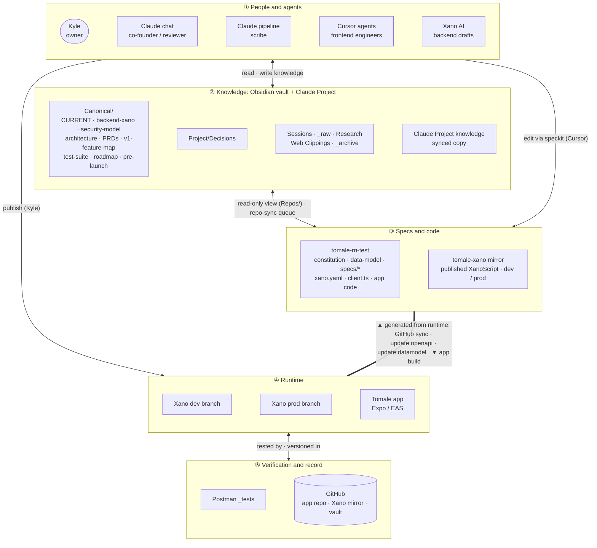
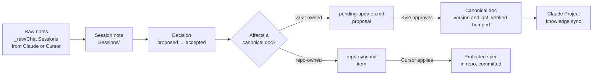

# Knowledge architecture: vault, repos, Xano and agents

> **Status: approved 2026-10-24 (v1.0).** Decision notes accepted; the migration stages are in progress.
>
> **Scope.** This document covers *where knowledge lives, who may change it, and how it moves*. *Who does what, and how work gets done* (roles, workflows, release, testing) is in [[operating-model]]. The two overlap on permissions; where they do, this document defines the permission and the operating model defines the process that uses it.

**Changes in v0.3:**
- the main diagram is now a five-layer stack, with approvals moved into a permissions table and a change-and-approval table
- relocation out of iCloud is decided
- a Cursor repo scan before the snapshot push
- Xano dev/prod branches and per-branch GitHub sync
- `affects` frontmatter field for tracing decision impact

**Changes from v0.1:**
- folders renamed to `Canonical/` and `Repos/`
- diagrams added
- order of authority and promotion path defined
- protected documents defined
- every existing folder mapped
- Xano and its GitHub mirror added as sources
- Cursor writes raw session notes
- one 17:00 automation pipeline
- Claude Project keeps decisions and syncs automatically
- word cap removed
- snapshots stage and V1 audit added
- data-model script moved earlier

---

## 1. Problem

The project's knowledge is spread across the Obsidian vault, the Cursor repo (`tomale-rn-test`), Xano itself, a working folder of staged `.xs` files, and copies in the Claude Project. Nothing says which version is current.

- **A fixed baseline drifts.** `Project/Plan`, `Project/Stack` and `Project/Cursor` date from April–May 2026, and most of Phase 1 contradicts them. Agents treat them as authoritative anyway.
- **Decisions have no lifecycle.** All 77 decisions say `status: current`.
- **Engineering specs exist twice.** The constitution and data model are in both the repo and the vault, and both are frozen.
- **The backend has no readable source.** The published XanoScript exists only inside Xano. Agents work from pasted or staged copies, which is how a stale `auth/login` draft nearly reintroduced user enumeration on 22/10.
- **Generated noise.** `wiki/` holds 584 LLM-wiki stubs.
- **Hygiene.** 14 of 16 Plan files have no frontmatter, 48 of 817 wikilinks are broken, and session notes use three different `type` values.
- **Unsafe storage.** The Cursor repo shows iCloud sync-conflict duplicates (§12), including inside `.git/`.

## 2. Principles

1. **One owner per fact.** Every fact has exactly one master copy. Everywhere else links to it, mirrors it read-only, or is generated from it.
2. **Live systems outrank documents** (§4).
3. **Current state is separate from history.** `Canonical/` says what is true now. Decisions, sessions and research record how we got here.
4. **Generate whatever can be generated.** The API contract and data model come from Xano.
5. **Protected documents are edited only through agreed processes** (§6).
6. **Automations propose; Kyle approves.** No scheduled task edits a canonical doc or a repo.
7. **Systems stay separate.** No agent has write access to Xano or to the Cursor repo except through the processes in [[operating-model]]. Specifically: no Xano MCP.
8. **Plain tools.** Markdown, frontmatter, links and git. No RAG or graph tooling.

## 3. Knowledge architecture diagrams

### 3.1 Knowledge stack

Read it top to bottom: people and agents work on knowledge, knowledge drives specs and code, specs and code drive the runtime, and the runtime is verified and recorded. Approvals are left out on purpose; they're in §3.2 and §3.3.



**Key:** `-->` / `<-->` read or write, as labelled. The thick line from ④ to ③ is generated automatically and is never edited by hand.

**Who can read and write each layer:**

| | Kyle | Claude chat | Claude pipeline | Cursor agents | Xano AI |
|---|---|---|---|---|---|
| **Canonical/** | R/W | R/W *(after approval)* | R, proposes | R | Knowledge tab copy |
| **Decisions** | R/W | R/W | W (drafts) | R | n/a |
| **Sessions, _raw** | R/W | R, writes raw | R/W | Writes raw only | n/a |
| **Claude Project knowledge** | R/W | R | W (sync) | n/a | n/a |
| **tomale-rn-test** (code + protected specs) | Merges | R | n/a | W, through protected processes (§6) | n/a |
| **tomale-xano mirror** | R | R | R (`git pull`) | R | n/a |
| **Xano (dev / prod)** | Publishes, merges | n/a | n/a | n/a | Drafts in the workspace |
| **Postman** | Runs | Designs tests | n/a | n/a | n/a |

### 3.2 Change and approval flow

| Change | Proposed by | Approved by | Applied by | Process |
|---|---|---|---|---|
| New fact or decision | Claude chat, Cursor (raw note), Kyle | Kyle (`proposed` → `accepted`) | Pipeline drafts the note | §3.3 promotion path |
| Canonical doc edit | Pipeline (`pending-updates`) or Claude chat | Kyle | Claude chat | Bump `version` / `last_verified` |
| Protected spec change | Claude chat or pipeline (`repo-sync` item) | Kyle | Cursor agent | [[operating-model]] §3.5 (classed, batched between slices, by PR) |
| Generated spec refresh | Anyone, after a backend change | n/a (mechanical) | Cursor / Kyle runs the script | `update:openapi`, `update:datamodel` |
| Backend change | Claude chat / Xano AI draft | Kyle | Kyle publishes on dev; merges dev → prod at release | [[operating-model]] §3.2 |
| Release to prod | Kyle | Kyle | Kyle | Xano merge dev → prod, publish once; EAS build |

### 3.3 Promotion path: how new knowledge becomes canonical



## 4. Order of authority and promotion path

**Order of authority** (what wins when two sources disagree):

1. **The live system:** Xano **prod** for what is live, Xano **dev** for work in progress (both mirrored in `tomale-xano`); the app code in `tomale-rn-test`. Agents review backend drafts against the dev mirror.
2. **Protected and generated specs:** the constitution, `data-model.md`, `xano.yaml` / `client.ts`, speckit specs.
3. **Canonical docs:** `Canonical/`.
4. **Accepted decisions.**
5. **Session notes.**
6. **Raw notes, research and the archive.**

A conflict between levels is a defect. Either the lower source gets corrected, or the higher one gets changed deliberately through the promotion path. Agents must state which source they relied on when sources disagree.

**Promotion path** (how new knowledge rises): raw note → session note → decision → canonical doc or protected spec (diagram 3.2). Nothing skips straight from chat into a canonical doc without being recorded as a decision, except corrections of plain fact (a typo, a wrong field name), which go through `pending-updates.md`.

## 5. Tiers and the full folder map

| Tier | Meaning | Loaded by agents |
|---|---|---|
| **1: Canonical** | Declarative: what is true now | By default (Claude Project, Cursor workspace) |
| **2: Decisions** | Why, with a lifecycle | Claude Project; on demand elsewhere |
| **3: History and reference** | How we got here | Only when asked |

**Every existing location, and where it goes:**

| Current location | Contents | Tier | Target | Action |
|---|---|---|---|---|
| `Project/Plan/1-prd-tomale-react-native-app-v1` | V1 product definition | 1 | `Canonical/prd/` | Keep as the V1 umbrella PRD, linked to `v1-feature-map` |
| `Project/Plan/2-build-plan` | Slice roadmap | 1 | `Canonical/roadmap.md` | Merge with phases 2–5 of the CTO plan; refresh |
| `Project/Plan/3-cto-tech-review`, `4-cto-improvements-list` | Dec 2025 review | 3 | `Project/_archive/` | Archive (historical record) |
| `Project/Plan/5-cto-implementation-plan` | Phases 1–5 | 1 → 3 | Remaining phases into `roadmap.md`; original to `_archive/` | Split |
| `Project/Plan/6-api-security-model` | Security model | 1 | `Canonical/security-model.md` | Move; rebuild the matrix from OpenAPI |
| `Project/Plan/documentation-refresh-backlog` | Refresh checklist | 1 (temporary) | Stays until B12, then archived | Becomes the work list for B8/B9 |
| `Project/Plan/knowledge-architecture`, `operating-model` | These plans | 1 | `Canonical/` | Move on approval |
| `Project/Plan/Feature PRDs/*` (9) | Feature PRDs | 1 | `Canonical/prd/` | Move; reconcile in B9 |
| `Project/Architecture/*` (4 flows + `.bak` files) | System flows | 1 | `Canonical/architecture/` | Move; delete `.bak` files after the git baseline |
| `Project/Stack/1–15` | Stack notes (Apr 2026) | 3 | `Project/_archive/stack/` | Archive once current facts are harvested into `backend-xano.md` / constitution items |
| `Project/Cursor/constitution, data-model, api-spec` | Copies of repo specs | none | Deleted (the repo is the master) | Delete after B6; `Repos/` replaces them |
| `Project/Cursor/sdd-flow, sdd-process-overview` | How Kyle uses speckit | 1 | Merged into [[operating-model]] | Merge, then archive |
| `Project/Decisions/*` (~90) | Decisions | 2 | Stays | Frontmatter backfill |
| `Project/Research/*` | Research clippings and notes | 3 | Stays | Frontmatter only |
| `Project/Research/Research Proposals/CFI…` | Innovate UK CfI bid | 3 | Stays (decision 2026-10-24) | Excluded from agent defaults |
| `Sessions/` (40) | Session notes | 3 | Stays (decision 2026-10-24) | Normalise `type` only |
| `_raw/Chat Sessions/` (+ `_archive/`) | Raw session input | 3 | Stays | Input folder for the pipeline |
| `_raw/Web Clippings/` | Clipped articles | 3 | Stays | Excluded from agent defaults |
| `Templates/` (session, decision, stack) | Note templates | none | Stays | Update the decision template to the new schema; retire the stack template |
| `wiki/` | LLM-wiki output | none | Deleted | After the git baseline (B2) |
| `.obsidian/` | App config | none | Stays | Git-ignore workspace files; LLM-wiki plugin removed |
| **Outside the vault:** `Desktop/…/Tech/tomale-v1-wiki/` | Deprecated legacy vault (empty Sessions) | none | Retired | Remove from scheduled-task folder lists; delete or archive the folder |
| **Outside the vault:** `Documents/Claude/Projects/Tomale-rn-v1/` | Claude working folder: staged `.xs` files, specs, drafts | none | Retired as a source | `.xs` files superseded by the Xano mirror; specs and drafts moved into the vault or archived |

**New in `Canonical/`:**
- `CURRENT.md`
- `backend-xano.md` (Xano conventions and gotchas, from `learnings`, decisions and `6. Backend - Xano`)
- `test-suite.md`
- `pre-launch-checklist.md`
- `roadmap.md`
- `v1-feature-map.md` (feature → PRD → slice → speckit spec → backend endpoints → status)
- `repo-sync.md`
- `pending-updates.md`

**New `Repos/`:**
- `Repos/tomale-rn-test/` symlinks to `.specify/memory`, `specs`, `.docs/prd`, `api/openapi`
- `Repos/tomale-xano/`, a read-only local clone of the Xano GitHub mirror (or a symlink to one)

## 6. Protected documents

These documents drive tools directly. They stay exactly where they are and change only through the listed process. Nobody, human or agent, edits them by hand outside it.

| Document | Location | Used by | Allowed editor and process |
|---|---|---|---|
| `constitution.md` | `tomale-rn-test/.specify/memory/` | Every speckit command; Cursor agents | Cursor agent running `/speckit.constitution`, from an approved `repo-sync` item; Kyle reviews the diff and commits |
| `data-model.md` | `tomale-rn-test/.specify/memory/` | `/speckit.plan`, agents | Generated only: `npm run update:datamodel` |
| `xano.yaml`, `client.ts` | `tomale-rn-test/api/` | The app's API client; agents | Generated only: `npm run update:openapi` |
| `specs/NNN-*/` (spec, plan, tasks, research, contracts, checklists) | `tomale-rn-test/specs/` | The speckit flow | Speckit commands in Cursor (`/specify`, `/clarify`, `/plan`, `/tasks`, `/implement`, `/analyze`) |
| `specify-rules.mdc` | `tomale-rn-test/.cursor/rules/` | Cursor (rules) | **Nobody.** Regenerated by `update-agent-context.sh` during `/speckit.plan`. Fix the content at its source (the feature `plan.md`); pin anything else only inside its `MANUAL ADDITIONS` block |
| `.specify/templates/*`, `.specify/scripts/*`, `.cursor/commands/speckit.*` | `tomale-rn-test/` | The speckit tool itself | Only by upgrading speckit; never edited for project content |
| `tomale-project.mdc`, `tomale-api.mdc` (new) | `tomale-rn-test/.cursor/rules/` | Cursor (rules) | Cursor agent from a `repo-sync` item |
| Published XanoScript | Xano (mirrored to `tomale-xano`) | The live backend | Kyle publishes in Xano; the mirror is never edited |
| `Canonical/*` | Vault | All agents | Claude or Kyle, only through approved `pending-updates` or a decision in session; `version` and `last_verified` bumped |

## 7. Sources of truth and new information

| Source | What it's the truth for | How agents read it | Writes |
|---|---|---|---|
| **Xano** | Backend behaviour, schema, data | GitHub mirror (code); `update:datamodel` (schema); `update:openapi` (`app` contract) | Kyle only (publish) |
| **Xano GitHub mirror** (`tomale-xano`) | Published XanoScript history | Local clone under `Repos/`, `git pull` by the pipeline | Xano only (one-way) |
| **`tomale-rn-test`** | App code and protected specs | Natively in Cursor; `Repos/` symlinks for the vault and Claude | Cursor agents (speckit and `repo-sync`), Kyle commits |
| **Vault** | Product, backend design, decisions, history | Obsidian; Claude through the desktop link; Cursor (`Canonical/` as a second workspace folder) | Claude and Kyle (canonical, decisions); pipeline (sessions, decisions, proposals); Cursor (raw notes only) |
| **Postman `_tests`** | Regression evidence | Run results exported to `_raw` when relevant | Kyle |
| **Claude Project knowledge** | Nothing; a synced copy | Claude chat | The pipeline sync only |
| **New information** | Comes from Claude chat, Cursor chat, Xano work, Pureprint/Stripe correspondence, tests | Enters only as raw notes → promotion path | n/a |

## 8. Frontmatter schema and linking

Applied to `Canonical/` and decisions. Session notes keep their template (only `type` is normalised). Links inside frontmatter are quoted.

| Field | Applies to | Values / notes |
|---|---|---|
| `type` | all | `plan`, `living-doc`, `architecture`, `prd`, `decision`, `session-note`, `research`, `reference` |
| `title` | all | Same as the filename (kebab-case) |
| `project` | all | `tomale-rn-v1` |
| `status` | all | Docs: `draft` / `current` / `historical`. Decisions: `proposed` / `accepted` / `superseded` |
| `version` | canonical docs, plans, PRDs | `MAJOR.MINOR`. Decisions are never versioned: they are superseded |
| `date` | all | Created |
| `last_verified` | canonical docs | Last checked against the live system; drives the staleness check |
| `owner` | all canonical docs | `vault` / `repo` / `generated` |
| `supersedes` / `superseded_by` | decisions, docs | `"[[note]]"` |
| `related` | optional | `"[[note]]"` list |
| `features` | PRDs, decisions, architecture | V1 feature ids from `v1-feature-map` (e.g. `F-characters`), so impact can be traced |
| `affects` | decisions | Canonical docs, protected specs and backend objects the decision changes (`"[[security-model]]"`, `constitution`, `store_orders`, `POST /store_orders`). Set when the note is created; drives reconcile and the weekly check |
| `tags` | optional | Short controlled list |

- **Decision lifecycle:** `proposed` → `accepted` → `superseded`. Promotion edits the canonical doc in the same pass (or queues `repo-sync`).
- **Backfill:** a script proposes statuses for the existing decisions; Kyle reviews the diff.
- **Links:** `[[filename]]` only, no folder paths; filenames unique across the vault. **One exception: links into `Repos/` are path-qualified** (e.g. `[[Repos/tomale-rn-test/memory/constitution|constitution]]`), because speckit reuses the same filenames (`spec`, `plan`, `tasks`, `research`, `quickstart`, `data-model`) in every feature folder. No vault note may use those names. (B4, 2026-10-24: 235 old path-style links rewritten to filename links.)

## 9. Generated specs

- **API contract (exists, working since 23/10).** `npm run update:openapi` fetches the private `app` docs (`XANO_APISPEC_URL=https://api.tomale.ai/apispec:1pgd39RE` + `XANO_APISPEC_TOKEN` in the gitignored `.env`), writes `xano.yaml`, regenerates `client.ts`. Run after any `app` endpoint change. `api-spec.md` is retired.
- **Data model (built by Cursor in B6, 28/10).** `scripts/update-data-model.mjs` → `npm run update:datamodel`. Reads every table's schema from the Xano Metadata API (`XANO_INSTANCE_URL` + `/api:meta`, `XANO_META_TOKEN` = the read-only `cursor-read` token, `XANO_WORKSPACE_ID`, all in the gitignored `.env`) and writes `.specify/memory/data-model.md`: a fixed preamble, then tables grouped by a domain map in the script. The run fails without writing if a live table is missing from the map or a mapped table no longer exists. Deterministic: a rerun with no schema change gives no diff. Run after schema changes.
- **XanoScript (new, B0).** Xano GitHub sync (on the Launch plan) mirrors every publish to `tomale-xano` on GitHub. It's read-only from Xano's side; building and publishing still happen in Xano. It replaces the staged `.xs` files. With the dev/prod split (V1 uses two Xano branches): many publishes on **dev** give many commits; at release, dev is merged into **prod** in Xano (*branch footer → Merge Branches → source dev, destination prod → review → Merge*), then prod is published once, giving one prod commit. Each Xano branch syncs to its own git branch. The local clone under `Repos/tomale-xano/` fetches both. Until the split exists, the single live branch syncs.
- **`webhooks` spec:** not exported (dropped from B6 on 28/10). Postman already has it, and the XanoScript mirror is the source for those endpoints.

## 10. Automations

All automations run on Kyle's Mac (they need the vault), so only when it's awake with the Claude desktop app open. Every step works in **catch-up** mode: it processes everything not yet processed, whatever the date, so a missed day is harmless.

| Task | When | Steps |
|---|---|---|
| **Daily knowledge pipeline** (replaces the two current tasks) | 17:00 weekdays | 1. `git pull` the `tomale-xano` clone. 2. Session notes from unprocessed `_raw/Chat Sessions` files (Claude and Cursor), archive the raw files. 3. Decision notes from new session notes (new schema). 4. **Reconcile:** proposed canonical edits → `pending-updates.md`; repo-owned changes → `repo-sync.md`. 5. Sync changed `Canonical/` docs and new decisions to Claude Project knowledge. 6. One-line summary of what it did. Never edits canonical docs or repos. |
| **Weekly staleness check** | Monday morning | Canonical docs whose `last_verified` is older than 30 days, broken links, decisions still `proposed` after 14 days → `pending-updates.md` |

Whether a scheduled task can write to Claude Project knowledge is checked in B11. If it can't, step 5 becomes a "sync project knowledge" step at the start of each Claude session.

## 11. Agent access

| Agent | Reads by default | May write | Never |
|---|---|---|---|
| **Claude chat** (Project, desktop link) | Project knowledge (Canonical + Decisions); whole vault and `Repos/` on demand | Vault: Canonical (after approval), Decisions, `_raw`, `repo-sync`, `pending-updates` | The app repo, Xano |
| **Claude pipeline** | `_raw`, Sessions, Decisions, Canonical | Sessions, Decisions, `pending-updates`, `repo-sync`, `_raw/_archive`, Project knowledge | Canonical docs, repos, Xano |
| **Cursor agents** | Repo; vault `Canonical/` (second workspace folder); `tomale-project.mdc` (always), `tomale-api.mdc` (`api/**`) | Repo (speckit and `repo-sync` processes); vault `_raw/Chat Sessions/` (raw notes only); tick `repo-sync` items | Vault canonical docs or decisions; Xano; protected docs outside their process |
| **Xano AI** | Workspace + Knowledge tab (fed from `Canonical/backend-xano.md`) | Drafts only | Publishing without Kyle's review against the published version in the `tomale-xano` mirror |

**Context guidance (no hard cap).** `CURRENT.md` is the entry point: phase, next tasks, open questions and links. It links out rather than repeating. Keep always-loaded Cursor rules short, because they're paid for on every request. Anything that's history stays out of default context.

## 12. Storage safety (prerequisite)

**iCloud Desktop & Documents sync is on** (confirmed 2026-10-24). The Cursor repo shows sync-conflict duplicates, all untracked by git: `.git/index 2`/`index 3`, `.github/workflows 2/`, `.tests/smoke.test 2.ts`, `app/(main)/(tabs)/_layout 2.tsx`, and `characters 2/`, `store 2/`, `bookshelf 2/`, `home 2/`, `settings 2/` (24 Oct and 7–10 Nov 2025), plus `.expo/web 2` and `dist/* 2`. Four of the tab folders and the smoke test differ from the originals. Git repos inside iCloud-synced folders can be corrupted.

**Decision:** keep iCloud sync on and **move all project working folders out of Desktop and Documents** to a local, unsynced folder:

```
~/Developer/tomale/
├── tomale-rn-test/        Cursor repo
├── tomale-v1-wiki/        Obsidian vault
└── tomale-xano/           read-only clone of the Xano mirror (created in B0)
```

**Relocation steps (B0a):**
1. Make sure every file is downloaded locally first (Finder → right-click the folder → *Download Now*), so nothing is left cloud-only.
2. Quit Cursor and Obsidian. Move (don't copy) each folder in Finder.
3. Re-open: Obsidian → *Open folder as vault* at the new path; Cursor → open the new repo path.
4. Update every reference to the old paths: scheduled-task folder lists, Claude desktop folder grants, Cursor workspace, memory, and `wiki_path_obsidian`.
5. Retire the legacy `Desktop/…/Tech/tomale-v1-wiki/` and the `Documents/Claude/Projects/Tomale-rn-v1/` working folder (contents archived into the vault first).

## 13. Migration stages

**Progress (2026-10-28):** B0 ✅ · B1 ✅ · B2 ✅ · B3 ✅ ([[knowledge-inventory]]) · B4 ✅ (merged 25/10) · B5 ✅ (merged 25/10) · B6 ✅ (generator built and run, PR #9 merged into `wip/pre-restructure-2026-10-24` 28/10) · B7 ✅ audit reviewed 28/10 ([[v1-audit]]); rulings applied on branch `b7-v1-audit`, pending Kyle's merge · Next: B8.

Each stage runs on a git branch → diff reviewed → merged. Each stage has a check, and a failed stage is reverted.

| Stage | Work | Check |
|---|---|---|
| **B0: Snapshots and storage** | (a) Relocation out of iCloud (§12). (b) Cursor **repo scan before any push**: secrets (`.env`, keys, tokens in code or history, e.g. gitleaks), large or binary files, and the `* 2` duplicates. Diff the duplicates against the originals and keep anything unique, then remove them; commit the uncommitted work on `006-foundations-http` to `wip/pre-restructure-2026-10-24`; push all branches (`0.1-FOUNDATIONS-ROUTER` isn't on GitHub, `master` is 1 ahead); tag `pre-knowledge-restructure`. (c) Xano: manual instance backup + Export Workspace (multidoc: definitions, records, drafts; *env vars hold secrets, so store the file encrypted, not in the vault or repo*) + Export Data (JSON); then turn on GitHub sync to the private `tomale-xano` repo. (d) Vault: zip backup outside the vault. | Tag on GitHub; first commit on `tomale-xano`; backup files stored |
| **B1: Approve plans** | This plan + [[operating-model]] + decision notes | Kyle approves; notes → `accepted` |
| **B2: Vault git** | Private repo `tomale-v1-wiki`; `git init`, `.gitignore`, first commit, push (Kyle, GitHub Desktop); Obsidian Git plugin; **symlink test** (create a test symlink to the repo, commit, confirm git stores it as a link, Obsidian opens through it, Obsidian Git doesn't stage files inside it) | Repo on GitHub; test passes or plan B (copies generated by script) |
| **B3: Inventory** | `Project/Plan/knowledge-inventory.md` built from §5, per file | Kyle reviews |
| **B4: Structure** | Create `Canonical/`, `Repos/`, `Project/_archive/`; moves with link rewriting; delete `wiki/`; remove the plugin; retire the legacy vault and the working folder as sources | Obsidian clean; no new broken links |
| **B5: Frontmatter and links** | Schema pass on canonical docs and decisions; decision status backfill; fix the 48 links; normalise session `type`; decision template updated | Kyle reviews the diff |
| **B6: Generated specs (Cursor)** | Build + run `update:datamodel`; run `update:openapi` (`webhooks` export dropped 28/10) | `data-model.md` matches live Xano |
| **B7: V1 audit** | Read every session note and decision; record each one's effect on V1 features and PRDs (feature tags); list conflicts and gaps | Audit report reviewed by Kyle |
| **B8: Canonical docs** | `CURRENT.md`, `backend-xano.md`, `security-model.md` (matrix from OpenAPI), `test-suite.md`, `pre-launch-checklist.md`, `roadmap.md`, `v1-feature-map.md`, architecture flows | Each has `last_verified`; Kyle reads `CURRENT.md` |
| **B9: PRD reconciliation** | Update the PRDs from the audit and `documentation-refresh-backlog` | Kyle approves each PRD |
| **B10: Repo sync (Cursor)** | `repo-sync` batch: constitution (SecureStore, the 401 interceptor, money in pence, error-code conventions), 002 plan fix, `tomale-project.mdc`, `tomale-api.mdc`, `.cursorignore` | Cursor commits; `specify-rules.mdc` regenerates cleanly |
| **B11: Agent access and automations** | Claude Project knowledge replaced with Canonical + Decisions and sync tested; `Canonical/` added to the Cursor workspace; Cursor raw-note convention; Xano Knowledge tab fed; pipeline + weekly task built and fired once | Test question per tool answered from current docs |
| **B12: Close-out** | Check the on-hold frontend branches for `auth/refresh` expecting 200; close `documentation-refresh-backlog` | Backlog empty |

Then: resume the frontend at Slice 100 (Characters).

## 14. Not doing

- RAG, vector search, graph tooling, or an LLM-wiki replacement.
- A Xano MCP, or any direct agent write access to Xano (decision 2026-10-24: keep the separation).
- Postman suite in CI, until the suite is split (see `defer-postman-suite-ci-until-suite-split`).
- Rewriting history: sessions and decisions are never edited for content, only for frontmatter and links.

## 15. Open questions

1. Can a scheduled task write Claude Project knowledge (§10 step 5)? Checked in B11. Kyle doesn't know; assume the fallback until tested.

**Resolved 2026-10-24:**
- iCloud sync is on → relocate (§12).
- Xano GitHub sync is available on the Launch plan, one git branch per Xano branch (§9).
- Old sessions stay where they are.
- `cursor-read` has database read scope.
- Folder names are `Canonical/` and `Repos/<repo>/`.
- GitHub: every Tomale repo lives in the private organisation **`tomale-ai-ltd`** (`tomale-rn-test`, `tomale-v1-wiki`, `tomale-xano`); the `tomale-ai` account is Kyle's login and the organisation owner.
- Symlink test passed (B2, 2026-10-24): git stores `Repos/` links as links (mode 120000), Obsidian opens files through them, and Obsidian Git shows a link as one item.

## Related decisions

- [[adopt-repo-vault-ownership-split-for-project-knowledge]]
- [[adopt-tiered-vault-structure-with-canonical-folder]]
- [[adopt-frontmatter-lifecycle-schema]]
- [[generate-data-model-and-api-contract-from-xano]]
- [[add-propose-only-reconcile-and-staleness-automations]]
- [[retire-obsidian-llm-wiki-plugin]]
- [[scope-agent-context-per-tool]]
- [[version-the-vault-with-git]]
- [[defer-postman-suite-ci-until-suite-split]]
- [[mirror-xano-workspace-to-github-read-only]]
- [[keep-agents-out-of-xano-no-mcp]]
- [[protect-speckit-and-generated-spec-documents]]
- [[adopt-order-of-authority-for-project-knowledge]]
- [[relocate-project-folders-out-of-icloud]]
- [[classify-and-batch-repo-sync-changes]]
